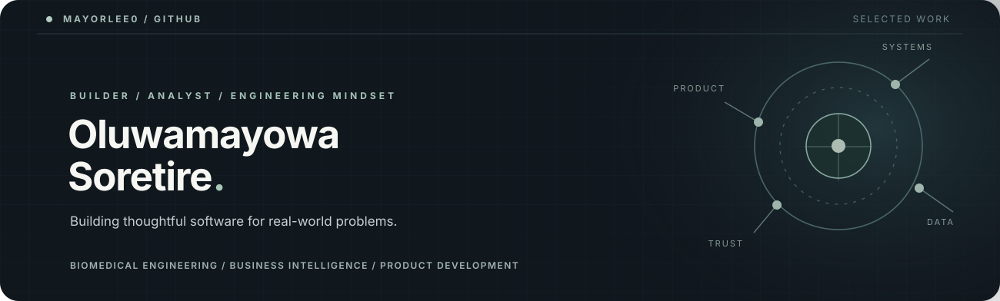
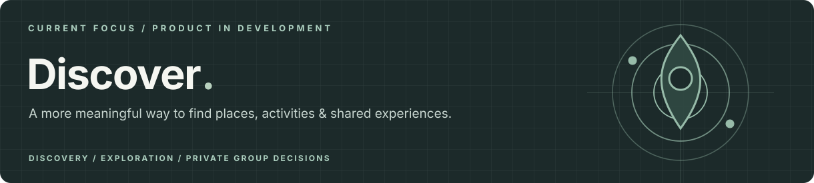
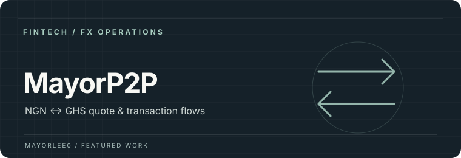
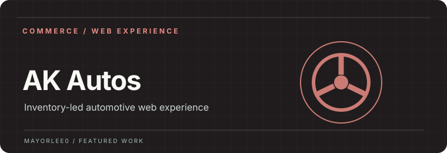
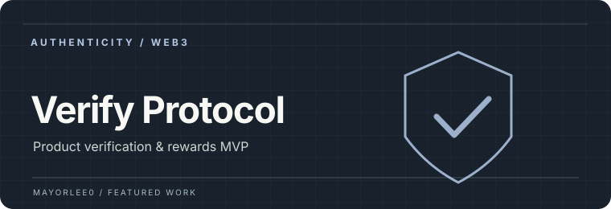

<!--
  PERSONAL GITHUB PROFILE · Mayorlee0
  Edit freely: all project copy, links, and sections are kept in this README.
  Images live in /assets. Private repositories are intentionally NOT linked as public source.
-->

  

<h2>Hi, I'm Mayowa 👋</h2>

I build **useful digital products** at the intersection of **software, business intelligence and real-world operations**. My background is in biomedical engineering, and I'm currently pursuing an **MBA in Business Intelligence & Data Analytics**.

I care about the complete experience: understanding a problem, designing something people can actually use, and making sure the data and systems behind it hold up.

**Based in Accra, Ghana** &nbsp;·&nbsp; [Repositories](https://github.com/Mayorlee0?tab=repositories) &nbsp;·&nbsp; [Email](mailto:soretiremayowa08@gmail.com)

---

### Currently building

**Discover** — a guest-first platform to help people find places and activities, explore with more confidence, and decide where to go together. The product brings together discovery, personal exploration, and private group decision-making rather than treating them as separate experiences.

`React` `TypeScript` `Vite` `Product Design` &nbsp;·&nbsp; **In development · Code private**

### Selected projects

<table>
  <tr>
    <td width="50%" valign="top">
      
      <h3>MayorP2P</h3>
      
A practical NGN ↔ GHS quote interface with server-calculated rates, historical rate views, WhatsApp handoff, and a protected admin workflow for transaction records.

      
<code>JavaScript</code> <code>Tailwind CSS</code> <code>Supabase</code>

      
<a href="https://mayorp2p.xyz">Website</a> &nbsp;·&nbsp; Source private

    </td>
    <td width="50%" valign="top">
      
      <h3>AK Autos</h3>
      
A mobile-first car and motorcycle dealership experience, with database-managed listings, controlled publishing, and direct customer enquiry flows.

      
<code>Next.js</code> <code>TypeScript</code> <code>Supabase</code>

      
<a href="https://akautos-sooty.vercel.app">Website</a> &nbsp;·&nbsp; Source private

    </td>
  </tr>
  <tr>
    <td width="50%" valign="top">
      
      <h3>Verify Protocol</h3>
      
An anti-counterfeit MVP exploring manufacturer-issued verification codes, protected authenticity checks, and Solana-based reward infrastructure.

      
<code>TypeScript</code> <code>Fastify</code> <code>Prisma</code> <code>Solana</code>

      
Prototype &nbsp;·&nbsp; Source private

    </td>
    <td width="50%" valign="top">
      
      <h3>Portfolio Tracker</h3>
      
A personal portfolio dashboard covering crypto, equities and cash, with transaction entry, holdings and P&amp;L views, and multi-currency reporting.

      
<code>Next.js</code> <code>TypeScript</code> <code>Supabase</code>

      
Product project &nbsp;·&nbsp; Source private

    </td>
  </tr>
</table>

### Skills & working toolkit

| Focus | Tools / experience |
| :-- | :-- |
| **Web products** | React, Next.js, TypeScript, JavaScript, Tailwind CSS |
| **Data & infrastructure** | SQL, Supabase, APIs, data modelling, Vercel |
| **Business intelligence** | Power BI, Excel, SPSS |
| **Design & process** | Figma, product scoping, UX decisions, GitHub |
| **Domain interests** | Healthcare technology, digital trust, fintech, decision-support systems |

### Earlier public repositories

For a look at older code and experiments: [Smart Contacts](https://github.com/Mayorlee0/Smart_Contacts) · [Choice-V1](https://github.com/Mayorlee0/Choice-V1) · [Aleo-tiktactor](https://github.com/Mayorlee0/Aleo-tiktactor).

---

**What matters to me:** solving a real problem, keeping the product understandable, and balancing design quality with reliable systems.

Open to conversations about product engineering, analytics, digital services, and technology for healthcare.

[GitHub](https://github.com/Mayorlee0) &nbsp;·&nbsp; [All repositories](https://github.com/Mayorlee0?tab=repositories) &nbsp;·&nbsp; [Get in touch](mailto:soretiremayowa08@gmail.com)
